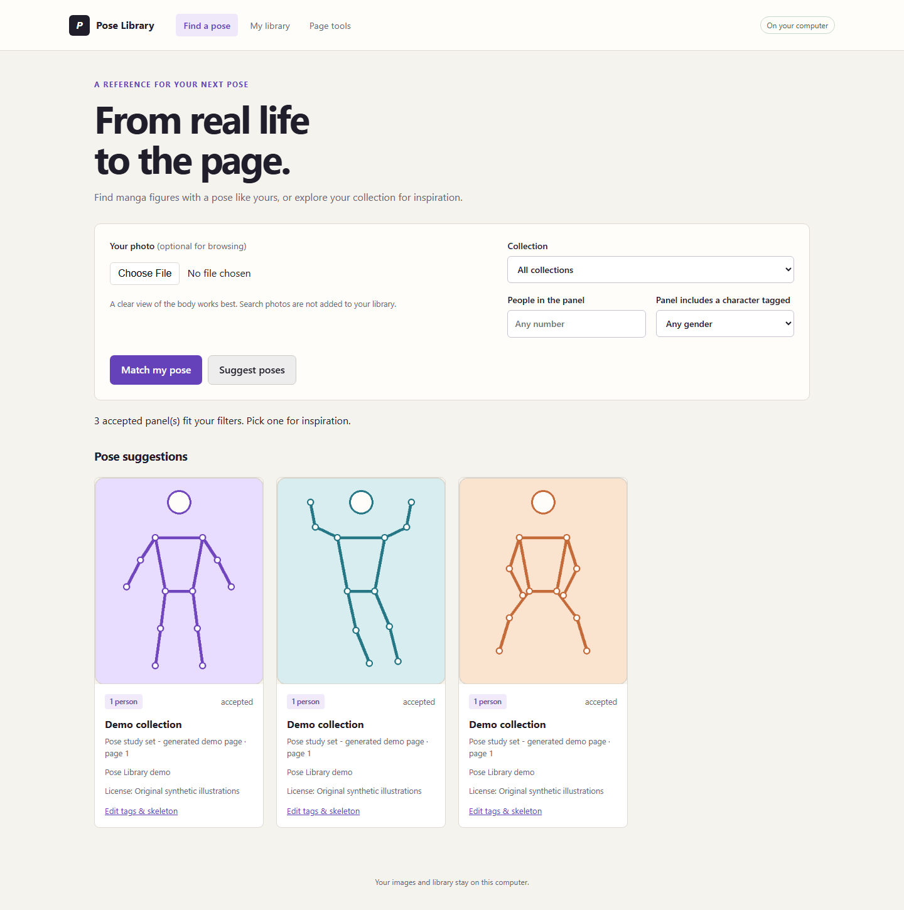
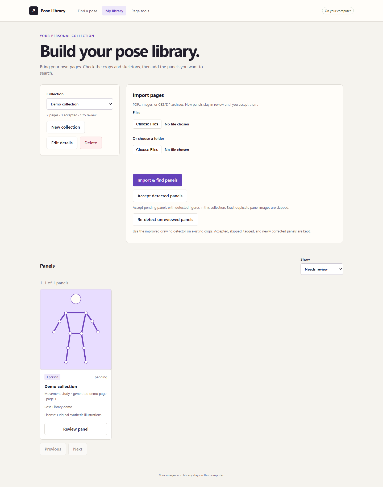
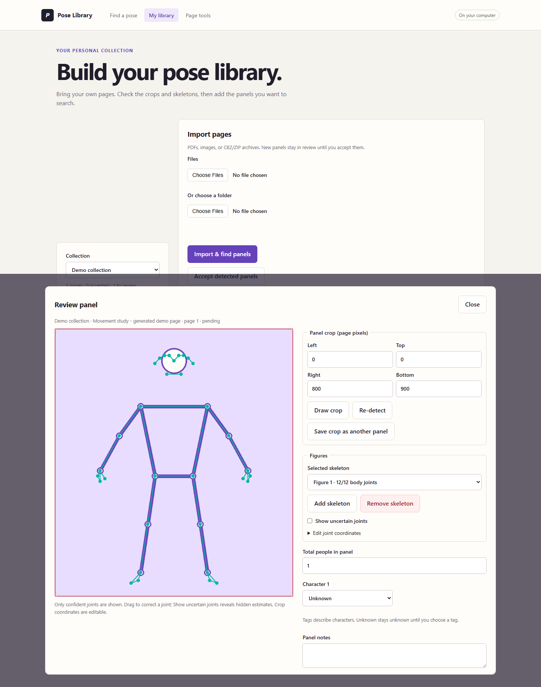

# Pose Library

**A local-first computer-vision app for finding illustrated poses from your own reference library.**

Import pages from PDFs, image folders, or CBZ/ZIP archives. Review and correct detected figures, then compare a photo pose with your accepted references—or browse the collection for inspiration. The app runs on your computer; no manga collection or sample source pages are included.



<p align="center"><em>Product screenshots use original, synthetic demo illustrations—not pages from a manga collection.</em></p>

## What it does

- **Build a searchable library:** import PDFs, individual images, folders, and CBZ/ZIP archives into collections with source and rights metadata.
- **Detect and review figures:** segment pages, detect illustrated people, estimate skeletons, and adjust crops, joints, participant counts, and character tags in an interactive editor.
- **Match across pose detectors:** compare a photo pose to figures in accepted panels using confident, shared body landmarks. Browse panels without a query photo, too.
- **Keep the person in control:** correct false detections, add missed skeletons, accept panels individually or in bulk, and skip exact duplicate panel images during bulk acceptance.
- **Keep source files local:** photos are used for the search request only; imports and query photos are not sent to a hosted service.

## Screenshots

### Find pose references

The suggestion view filters accepted panels by collection, participant count, and character tag. Matching a photo uses the same results view, ordered by relative pose distance.

### Import and review a collection



Imports run as background jobs with progress, warnings, and cancellation. The review queue keeps detected panels out of search until they are accepted.

### Correct a detected pose



The editor overlays the skeleton on the source page. Adjust joints by dragging or entering coordinates, redraw a crop, add or remove a figure, and record participant count and tags.

## How it works

```text
PDF / image / CBZ
       │
       ▼
Page rendering and panel segmentation
       │
       ▼
Illustrated-person detection → pose estimation
       │
       ▼
Human review and correction → accepted panel catalog
                                      ▲
Photo → pose estimation → body-joint matching
```

- **Illustrated pages:** a HumanArt-trained YOLOX detector finds people, followed by RTMPose body estimation. No full-page fallback skeleton is created when no person is detected.
- **Query photos:** MediaPipe estimates up to eight poses per image.
- **Matching:** compare the 12 shared shoulder, elbow, wrist, hip, knee, and ankle landmarks. Confidence scores suppress uncertain joints; image aspect ratio, scale, and translation are accounted for. Partial matches require at least four shared body landmarks and receive a coverage penalty.
- **Persistence:** SQLite stores collections, provenance, review state, and pose records. Rendered pages are kept in a local assets directory and served through catalog-backed routes.

## Technology

| Area | Tools |
| --- | --- |
| Application and API | Python 3.12, FastAPI, Uvicorn |
| Pose estimation | MediaPipe, RTMPose, YOLOX, ONNX Runtime |
| Image and PDF processing | Pillow, NumPy, pypdfium2 |
| Persistence | SQLite |
| Interface | Jinja templates, vanilla JavaScript, HTML canvas |
| Verification | `unittest`, FastAPI `TestClient`, synthetic image/PDF fixtures |

## Run locally

Requires Python 3.12. The setup script downloads the official pose-model assets (approximately 150 MiB) to the ignored local model directory.

```powershell
python -m venv venv
.\venv\Scripts\Activate.ps1
python -m pip install -r requirements-dev.txt
python scripts/setup_pose_models.py
python -m uvicorn app.main:app --host 127.0.0.1 --port 8000
```

Open [http://127.0.0.1:8000](http://127.0.0.1:8000). Use one server worker per local library. For a different data location, set `POSE_DATA_DIR`; for model assets, set `POSE_MODEL_DIR`.

## Verify

```powershell
python -m unittest discover -s tests -v
```

The tests cover imports, review and correction, search ranking and filters, cancellation, provenance, persistence, migration, and validation. Pipeline tests stub pose inference, so they check application behavior without claiming to measure model accuracy.

## Engineering notes and limitations

- **Review before indexing:** imported panels begin as pending. The bulk action accepts pending panels that have detected figures and skips exact pixel-identical crops already accepted in the library or earlier in that action. It leaves panels without detections for manual review.
- **Bounded local imports:** batches support up to 20,000 files, 1 GiB per file, and 4 GiB total. PDFs are limited to 10,000 pages; source images to 40 megapixels; archive images to 100 MiB each.
- **Search distance is not a probability:** results are ranked by relative pose distance, not an accuracy percentage. Matching does not compare group arrangements or guarantee that the top result is the best reference.
- **Detection has edge cases:** foreshortened or highly stylized figures, overlapping or borderless panels, and incomplete poses can be missed. Participant count is an estimate based on detected skeletons, not a census of every character.
- **No bundled content:** users provide their own sources and are responsible for confirming the applicable permissions. The generated screenshots above avoid displaying private or third-party collection images.

## API

Interactive API documentation is available at `/docs` while the app is running.

| Endpoint | Purpose |
| --- | --- |
| `POST /api/datasets/{id}/imports` | Start a background import from uploaded files |
| `GET /api/imports/{id}` / `POST /api/imports/{id}/cancel` | Check progress or cancel an import |
| `POST /api/datasets/{id}/accept-detected` | Bulk-accept detected panels, skipping exact image duplicates |
| `GET` / `PATCH /api/panels/{id}` | Read or update panel review data |
| `POST /api/search` | Match an uploaded photo against accepted panels |

## Data location

By default, the local data directory is `app/data/` (excluded from Git). It contains `catalog.sqlite3`, rendered `pages/`, and temporary `staging/` uploads. Stop the app before copying this directory for a backup. Original PDFs and archives are not retained after import.
